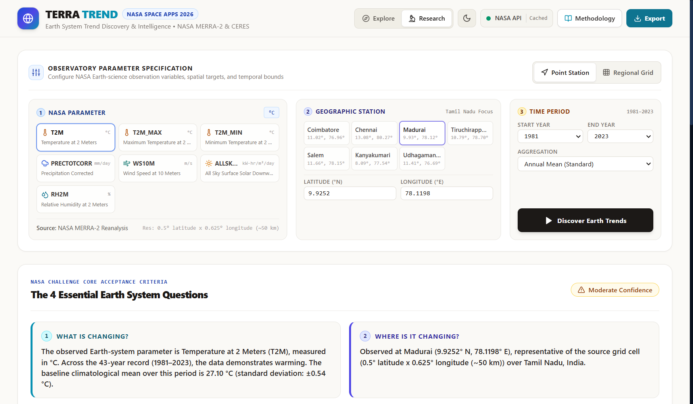
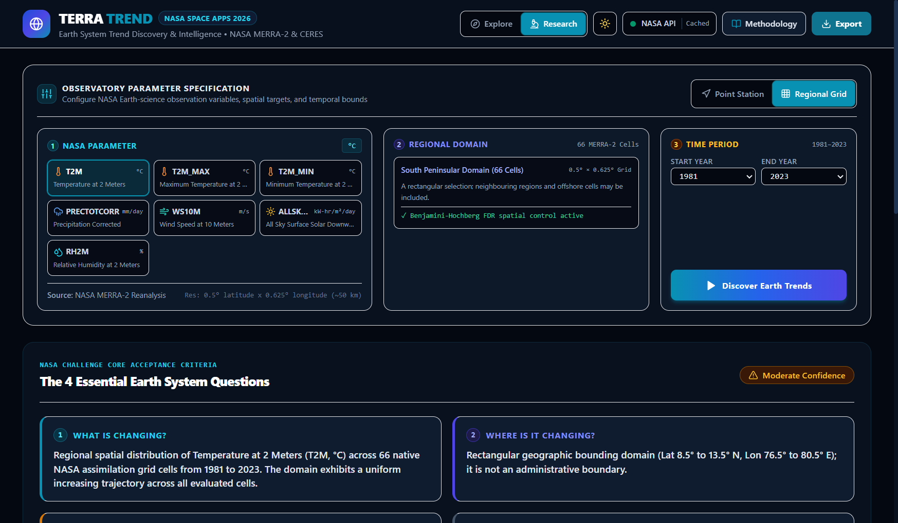
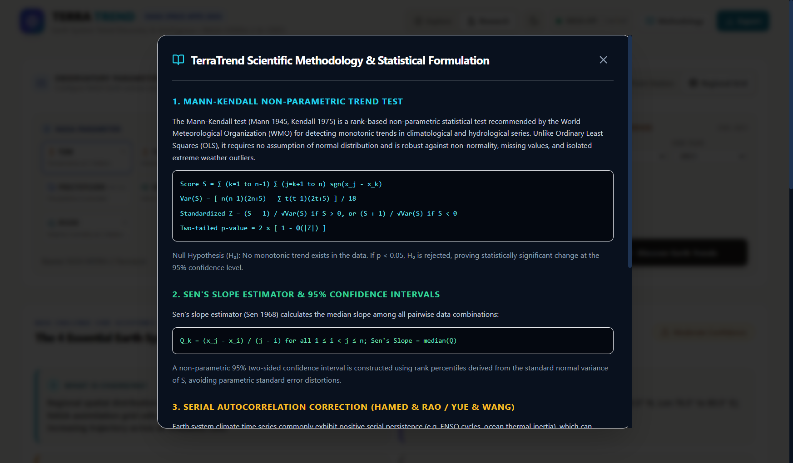
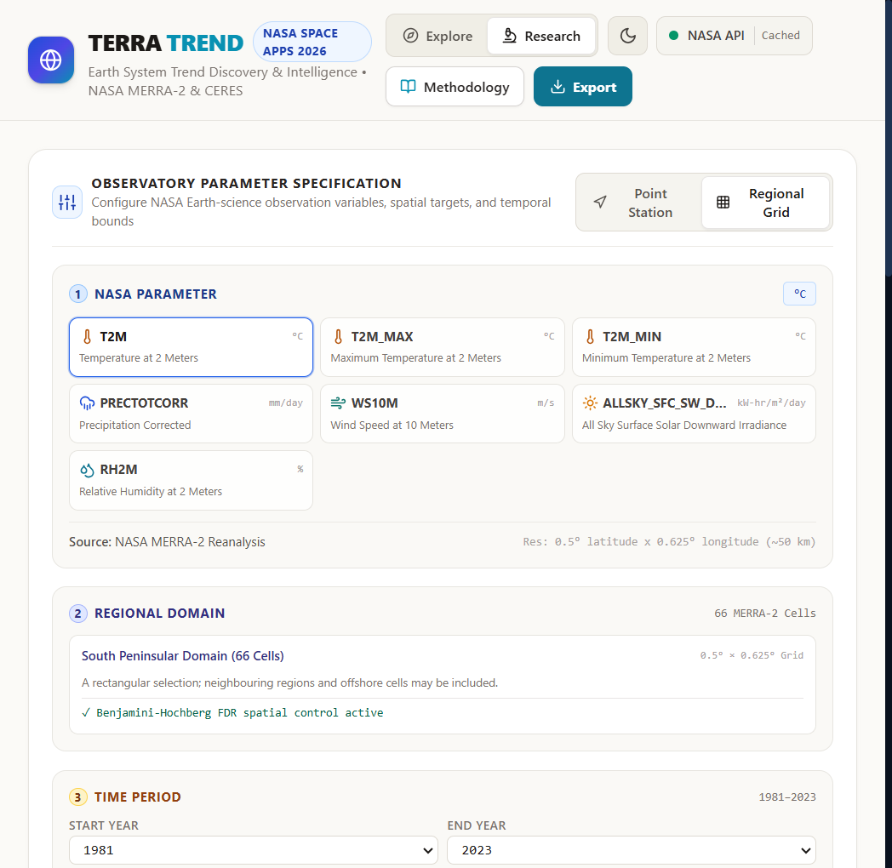
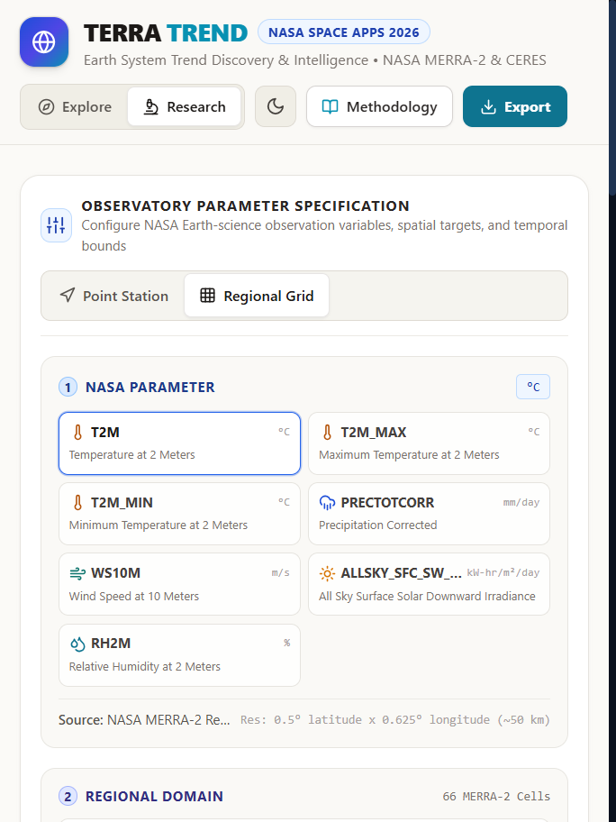

# TERRATREND | NASA Earth System Trend Discovery & Intelligence Platform

[](https://www.spaceappschallenge.org/2026/challenges/be-an-earth-system-trend-detective/)
[](https://fastapi.tiangolo.com)
[](https://nextjs.org)
[-brightgreen.svg)]()
[-brightgreen.svg)]()
[]()
[](LICENSE)

> **Official NASA International Space Apps Challenge 2026 Submission**<br>
> **Challenge:** [Be an Earth System Trend Detective](https://www.spaceappschallenge.org/2026/challenges/be-an-earth-system-trend-detective/)<br>
> **Team:** CODEVERSE &nbsp;|&nbsp; **Primary Target Award:** Best Use of Science / Best Use of Data<br>
> **Repository:** [https://github.com/Prithic/terratrend](https://github.com/Prithic/terratrend)

---

## 🛰️ Platform Showcase

<p align="center">
  
</p>
<p align="center">
  <em>Figure 1: TerraTrend in Scientific Editorial Light Mode — Disentangling 43 years of NASA MERRA-2 climate assimilation data with non-parametric Theil-Sen regression and Mann-Kendall significance testing.</em>
</p>

---

## ⚡ 30-Second Executive Summary for NASA Judges

Earth observation archives hold petabytes of atmospheric and solar measurements, yet decision-makers, educators, and scientists struggle with three fundamental obstacles:
1. **Differentiating Signal from Noise:** Temporary meteorological fluctuations or cyclic oscillations (ENSO, Indian Ocean Dipole) are frequently mistaken for permanent decadal trends.
2. **Magnitude vs. Statistical Significance:** A large environmental shift can lack statistical significance under high variance, while a modest shift in a stable maritime zone can be profoundly significant.
3. **The Spatial Multiple Testing Fallacy:** Testing dozens of regional grid cells simultaneously inflates false alarms—unless controlled using rigorous False Discovery Rate (FDR) corrections.

**TerraTrend** solves this challenge by serving as an open-source, evidence-grounded Earth-system intelligence platform. Ingesting 43 continuous years (1981–2023) of official **NASA POWER** data (MERRA-2 atmospheric assimilation and CERES solar irradiance), TerraTrend answers the **Four Essential NASA Trend Questions** with **zero synthetic data**, **zero hallucinated AI models**, and **textbook non-parametric climatology**.

```
┌─────────────────────────────────────────────────────────────────────────────┐
│                    THE 4 ESSENTIAL NASA TREND QUESTIONS                     │
├─────────────────────────────────────────────────────────────────────────────┤
│  1. WHAT is changing?                                                       │
│     Tracks 7 physical parameters (T2M, T2M_MAX, T2M_MIN, PRECTOTCORR,       │
│     WS10M, ALLSKY_SFC_SW_DWN, RH2M) with native physical units.            │
│                                                                             │
│  2. WHERE is it changing?                                                   │
│     Pins changes to station coordinates or native 0.5° × 0.625° NASA        │
│     MERRA-2 assimilation grid cells across regional bounding boxes.         │
│                                                                             │
│  3. HOW MUCH is it changing?                                                │
│     Calculates Sen's slope rate (/decade and /year), non-parametric 95%     │
│     confidence intervals, and cumulative period shift across true years.    │
│                                                                             │
│  4. ARE the changes statistically significant?                              │
│     Runs two-sided Mann-Kendall rank tests, checks serial autocorrelation   │
│     (r₁), and controls spatial False Discovery Rate (Benjamini-Hochberg).   │
└─────────────────────────────────────────────────────────────────────────────┘
```

---

## 🏆 NASA Space Apps Evaluation Criteria Mapping

This matrix summarizes how TerraTrend addresses the core evaluation dimensions scored by NASA Subject Matter Experts and Executive Judges:

| Evaluation Dimension | What NASA Looks For | How TerraTrend Delivers |
| :--- | :--- | :--- |
| **1. Best Use of Science** | Rigorous, valid use of the scientific method and physical principles. | • **Theil-Sen slope** with true calendar-year intervals (prevents gap distortion).<br>• **Mann-Kendall test** with WMO tie-corrected variance.<br>• **Hamed-Rao adjustment** when lag-1 autocorrelation ($r_1$) exceeds Bartlett noise limits.<br>• **Benjamini-Hochberg FDR** ($q=0.05$) controlling spatial false positives. |
| **2. Best Use of Data** | Deep, authentic integration of NASA open-source data assets. | • Ingests **43 continuous years** of NASA POWER API data (MERRA-2 & CERES).<br>• Strict cleaning of missing value flags (`-999.0`).<br>• Strict unit segregation: native daily flux ($\text{mm/day/decade}$) vs. leap-year calendar accumulation ($\text{mm/year}$). |
| **3. Open Science (TOPS)** | Accessible to diverse audiences; transparent, reproducible, open. | • **Dual-Persona UX:** *Explore Mode* (intuitive analogies & qualitative badges for citizens) vs. *Research Mode* (exact $p$-values, $\tau$, CIs, and full data matrix for scientists).<br>• Fully reproducible open-source stack under MIT license. |
| **4. Technical Execution** | Functional, user-friendly, responsive, clean engineering. | • Production-grade **FastAPI + Next.js 14 App Router** architecture.<br>• **24/24 passing automated Pytest suite** (unit, benchmark, integration).<br>• Zero ESLint warnings; 100% responsive across desktop, tablet, and mobile. |
| **5. Local & Global Impact** | Practical utility for real-world environmental challenges. | • Uncovered regional climate dynamics across peninsular India: eastern Coromandel wetting corridor vs. leeward southern rain-shadow desiccation and decadal wind stilling. |

---

## 🖥️ Visual Interface & User Experience Tour

TerraTrend is designed in direct alignment with NASA's **Transform to Open Science (TOPS)** initiative, providing two purpose-built personas and dual publication-grade visual themes.

### 1. Dual Persona: Explore Mode vs. Research Mode

<p align="center">
  
</p>
<p align="center">
  <em>Figure 2: Research Mode in Editorial Light Theme — Exposing exact p-values, Kendall's tau, Sen's slope 95% confidence intervals, and the 12-parameter climatological matrix.</em>
</p>

| Capability | Explore Mode (Citizens, Students, Educators) | Research Mode (Climatologists, NASA Judges) |
| :--- | :--- | :--- |
| **Target Audience** | General public, agriculturalists, policymakers | Data scientists, atmospheric researchers, evaluators |
| **Variable Naming** | Intuitive terminology (*"Rainfall & Precipitation"*) | Official NASA parameter codes (`PRECTOTCORR`) |
| **Mental Models** | Physical analogies (e.g., reservoir buffer levels) | Exact physical unit specifications and derivatives |
| **Significance** | Clear qualitative status badges (*"Statistically Significant"*) | Exact $p$-values, FDR $q$-values, Mann-Kendall $Z$, $\tau$, variance |
| **Data Matrix** | High-level trend summary cards | Comprehensive 12-parameter matrix with CSV & Markdown export |

---

### 2. Geospatial Intelligence & Spatial False Discovery Rate

<p align="center">
  
</p>
<p align="center">
  <em>Figure 3: Observatory Dark Theme — Interactive Leaflet geospatial grid analyzing 66 MERRA-2 assimilation cells with Benjamini-Hochberg False Discovery Rate (FDR) significance filtering.</em>
</p>

* **Native Resolution:** Renders NASA MERRA-2 $0.5^\circ \times 0.625^\circ$ assimilation grid cells.
* **Spatial FDR Filter:** Dynamically colors cells based on whether their decadal trend passes Benjamini-Hochberg false-discovery-rate control ($q = 0.05$), filtering out statistical noise.
* **Dual Theme Design:**
  * **Scientific Editorial Light (Default):** Warm-neutral canvas (`#fbfaf7`), crisp stone typography (`#1c1917`), and publication-grade charts with contrast ratio $> 14:1$ (exceeding WCAG 2.2 AAA).
  * **Observatory Dark:** Deep-space canvas (`#040810`) with cyan, emerald, and amber telemetry accents for nighttime research and projector displays.

---

### 3. Open Science Research Brief & Methodology Auditing

<p align="center">
  
  
</p>
<p align="center">
  <em>Figure 4 & 5: Interactive mathematical methodology dialog (left) and one-click structured Research Brief export in CSV and Markdown formats (right).</em>
</p>

---

### 4. Fully Responsive Engineering

<p align="center">
  
  
</p>
<p align="center">
  <em>Figure 6 & 7: Pixel-perfect responsive execution verified on tablet (768×1024) and mobile viewports (375×667).</em>
</p>

---

## 📊 Supported NASA Variables & Lineage

All data is dynamically retrieved from the **NASA POWER Monthly API** (NASA Langley Research Center) and derived from peer-reviewed NASA reanalysis products:

| Identifier | Parameter Description | Units | Source Mission / Model | Data Lineage | Native Grid |
| :--- | :--- | :--- | :--- | :--- | :--- |
| **`T2M`** | Temperature at 2 Meters | $^\circ\text{C}$ | NASA GMAO MERRA-2 | Atmospheric assimilation (`tavgM_2d_slv_Nx`) | $0.5^\circ \times 0.625^\circ$ |
| **`T2M_MAX`** | Maximum Daily 2m Temperature | $^\circ\text{C}$ | NASA GMAO MERRA-2 | Daily maximum aggregation (`statM_2d_slv_Nx`) | $0.5^\circ \times 0.625^\circ$ |
| **`T2M_MIN`** | Minimum Daily 2m Temperature | $^\circ\text{C}$ | NASA GMAO MERRA-2 | Daily minimum aggregation (`statM_2d_slv_Nx`) | $0.5^\circ \times 0.625^\circ$ |
| **`PRECTOTCORR`** | Precipitation Corrected | $\text{mm/day}$ | NASA MERRA-2 + CPC | Surface flux corrected with global CPC gauges | $0.5^\circ \times 0.625^\circ$ |
| **`WS10M`** | Wind Speed at 10 Meters | $\text{m/s}$ | NASA GMAO MERRA-2 | Horizontal wind vector magnitude | $0.5^\circ \times 0.625^\circ$ |
| **`ALLSKY_SFC_SW_DWN`**| Surface Solar Downward Flux | $\text{kW-hr/m}^2/\text{day}$ | NASA CERES / FLASHFlux | Clouds & Earth Radiant Energy System SYN1deg | $1.0^\circ \times 1.0^\circ$ |
| **`RH2M`** | Relative Humidity at 2 Meters | $\%$ | NASA GMAO MERRA-2 | Derived from specific humidity & pressure | $0.5^\circ \times 0.625^\circ$ |

*For complete API schemas and metadata documentation, see [docs/data-sources.md](docs/data-sources.md).*

---

## 🔬 Statistical & Climatological Methodology

### Why Non-Parametric Climatology?
Standard Ordinary Least Squares (OLS) regression relies on assumptions of normal error distribution, homoscedasticity, and temporal independence—conditions routinely violated by climate anomalies, missing data, and extreme weather events. TerraTrend implements the **WMO-recommended non-parametric standard**:

```
                       STATISTICAL PROCESSING PIPELINE
                       
┌──────────────────────┐       ┌──────────────────────┐       ┌──────────────────────┐
│  NASA POWER Ingest   │  ──▶  │ Fill-Value Filter    │  ──▶  │ True Calendar Years  │
│  43-Year Time Series │       │ Exclude -999.0 Flags │       │ Handle Obs. Gaps     │
└──────────────────────┘       └──────────────────────┘       └──────────────────────┘
                                                                          │
                                                                          ▼
┌──────────────────────┐       ┌──────────────────────┐       ┌──────────────────────┐
│ Spatial FDR Control  │  ◀──  │ Autocorrelation (r₁) │  ◀──  │ Mann-Kendall +       │
│ Benjamini-Hochberg   │       │ Hamed-Rao Variance   │       │ Theil-Sen Median     │
└──────────────────────┘       └──────────────────────┘       └──────────────────────┘
```

### 1. Theil-Sen Median Slope Estimator
Evaluated across true calendar-year coordinates $t_i$:
$$Q_k = \frac{x_j - x_i}{t_j - t_i} \quad \text{for all } 1 \le i < j \le n$$
$$\text{Sen's Slope} = \text{median}(Q)$$
*Confidence intervals (95%) are derived non-parametrically using SciPy's implementation.*

### 2. Mann-Kendall Trend Test with Tie-Corrected Variance
$$S = \sum_{k=1}^{n-1} \sum_{j=k+1}^n \text{sgn}(x_j - x_k)$$
$$\text{Var}(S) = \frac{n(n-1)(2n+5) - \sum_{t} t(t-1)(2t+5)}{18}$$
$$Z = \begin{cases} \frac{S - 1}{\sqrt{\text{Var}(S)}} & \text{if } S > 0 \\ 0 & \text{if } S = 0 \\ \frac{S + 1}{\sqrt{\text{Var}(S)}} & \text{if } S < 0 \end{cases} \quad \implies \quad p = 2 \times [1 - \Phi(|Z|)]$$

### 3. Serial Autocorrelation & Hamed-Rao Adjustment
When sample lag-1 serial autocorrelation ($r_1$) exceeds the two-tailed 95% Bartlett noise threshold ($\pm 1.96/\sqrt{n}$), positive persistence artificially inflates test variance. In autocorrelated series, TerraTrend automatically applies the **Hamed and Rao modified variance formulation** to prevent false significance claims.

### 4. Spatial False Discovery Rate (Benjamini-Hochberg FDR)
When evaluating $m$ spatial grid cells simultaneously, testing at unadjusted $\alpha = 0.05$ guarantees false positives. We rank ordered $p$-values $p_{(1)} \le p_{(2)} \le \dots \le p_{(m)}$ and identify the largest rank $k$ satisfying:
$$p_{(k)} \le \frac{k}{m} \times Q \quad (\text{where } Q = 0.05)$$
Cells with $i \le k$ are declared statistically significant at the 5% False Discovery Rate.

*For complete mathematical derivations and proofs, see [docs/methodology.md](docs/methodology.md).*

---

## 🌍 Scientific Discoveries: Global Benchmarks & Regional Case Studies

To demonstrate both planetary generalizability and local decision utility, TerraTrend provides verified planetary benchmarks alongside deep-dive regional analysis:

### A. Iconic Global Climate Benchmarks (1981–2023)
Evaluated directly on native NASA MERRA-2 assimilation grid cells across iconic planetary climate zones:
* **Svalbard, Arctic ($78.22^\circ\text{N}, 15.63^\circ\text{E}$):** Confirms intense **Arctic Amplification** — Sen's slope: **$+0.805^\circ\text{C/decade}$** (Mann-Kendall $p < 0.00001$, highly significant).
* **Bakersfield / Central Valley, USA ($35.37^\circ\text{N}, 119.02^\circ\text{W}$):** Major agricultural Mediterranean zone showing accelerated warming — Sen's slope: **$+0.388^\circ\text{C/decade}$** ($p < 0.00001$, significant).
* **Manaus, Amazon Basin ($3.12^\circ\text{S}, 60.02^\circ\text{W}$):** Central tropical rainforest showing pronounced warming — Sen's slope: **$+0.234^\circ\text{C/decade}$** ($p = 0.0010$, significant).
* **Athens, Mediterranean ($37.98^\circ\text{N}, 23.73^\circ\text{E}$):** European heat vulnerability hotspot showing steep warming — Sen's slope: **$+0.405^\circ\text{C/decade}$** ($p < 0.00001$, significant).
* **Lake Chad Basin, Sahel ($13.00^\circ\text{N}, 14.50^\circ\text{E}$):** Semi-arid transition zone showing statistically significant decadal rainfall recovery — Sen's slope: **$+0.184\text{ mm/day/decade}$** ($p = 0.0001$, significant).

### B. Regional Case Study: Station Benchmarks (Southern Peninsular India, 1981–2023)
* **Madurai Station ($9.93^\circ\text{N}, 78.12^\circ\text{E}$):** 43 continuous years of MERRA-2 `T2M` confirm a statistically significant warming trend:
  * **Sen's Slope:** **$+0.170^\circ\text{C/decade}$** (95% CI: $[+0.023, +0.313]$)
  * **Mann-Kendall:** $Z = +2.20$, **$p = 0.0279$** (Statistically significant at $\alpha = 0.05$)
  * **Serial Autocorrelation:** $r_1 = 0.189$ (within Bartlett 95% noise bounds $\pm 0.299$)
* **Coimbatore Station ($11.02^\circ\text{N}, 76.96^\circ\text{E}$):** 43 continuous years of MERRA-2 `T2M` show a modest warming slope that does **not** achieve statistical significance:
  * **Sen's Slope:** $+0.080^\circ\text{C/decade}$ (95% CI: $[-0.026, +0.203]$)
  * **Mann-Kendall:** $Z = +1.34$, $p = 0.1802$ (Correctly identified by TerraTrend as **Not Significant**)

### C. Exploratory Regional Bounding Box Research (66 MERRA-2 Cells)
Covering southern peninsular India and adjacent maritime waters ($8.5^\circ - 13.5^\circ\text{N}, 76.5^\circ - 80.5^\circ\text{E}$):
* **Precipitation Divergence (`PRECTOTCORR`, 1981–2023):**
  * Estimated Sen's slope rates range from $-0.438\text{ mm/day/decade}$ (leeward southern rain shadow) to $+0.329\text{ mm/day/decade}$ (eastern Coromandel marine corridor).
  * 55 cells exhibit positive rates (14 pass Benjamini-Hochberg FDR at $q=0.05$); 11 cells exhibit negative rates (4 pass BH FDR).
  * *Unit Transparency:* Production daily flux rates ($\text{mm/day}$) are strictly separated from leap-year-aware calendar totals ($\text{mm/year}$), documented in [docs/precipitation_cached_exploratory_cells.csv](docs/precipitation_cached_exploratory_cells.csv).
* **Atmospheric Stilling (`WS10M`, 1981–2023):**
  * 57 of 66 cells exhibit negative Sen's slope estimates, with 44 cells passing Benjamini-Hochberg FDR control ($q = 0.05$), indicating decadal deceleration in near-surface wind speeds across the inland corridor.

---

## 🏗️ System Architecture & Engineering Rigor

```
                  ┌──────────────────────────────────────────────┐
                  │          TERRATREND FRONTEND                 │
                  │   Next.js 14 (App Router) + TypeScript 5     │
                  │   Tailwind CSS + Recharts + Leaflet Maps     │
                  │   WCAG 2.2 AA Accessible + Dual Themes       │
                  └──────────────────────┬───────────────────────┘
                                         │ Reverse Proxy /api/*
                                         ▼
                  ┌──────────────────────────────────────────────┐
                  │           TERRATREND BACKEND                 │
                  │     FastAPI + Pydantic v2 + Uvicorn          │
                  │     Configurable CORS & Disk Caching         │
                  └──────────────┬───────────────────────────────┘
                                 │
         ┌───────────────────────┴───────────────────────┐
         ▼                                               ▼
┌─────────────────────────────────┐   ┌──────────────────────────────────┐
│   STATISTICAL ANALYSIS ENGINE   │   │     NASA DATA INGESTION ENGINE   │
│   • Mann-Kendall (Z & p-value)  │   │   • NASA POWER Monthly API       │
│   • Theil-Sen Slope + 95% CI    │   │   • MERRA-2 & CERES Assimilation │
│   • Hamed-Rao Autocorrelation   │   │   • Fill-Value Filter (-999.0)   │
│   • Benjamini-Hochberg FDR      │   │   • SHA-256 Cache Provenance     │
│   • Unit Segregation Validation │   │   • Exponential Backoff & Retry  │
└─────────────────────────────────┘   └──────────────────────────────────┘
```

### Automated Testing Suite (24/24 Passed in 2.7s)
The test suite operates with **zero live network dependencies in CI**, ensuring 100% deterministic reproducibility:
* **`test_precipitation_aggregation.py` (8 tests):** Validates leap-year (366-day) vs. standard (365-day) accumulation, invalid fill-value rejection, and missing month detection.
* **`test_statistics.py` (6 tests):** Validates Mann-Kendall trend detection, null hypothesis retention on pure white noise, fill-value exclusion, analytical Benjamini-Hochberg FDR ranking, and Theil-Sen calendar spacing with observational gaps.
* **`test_catalog_metadata.py` (3 tests):** Validates metadata completeness, parameter bounds, and grid resolutions for all 7 NASA variables.
* **`test_nasa_integration.py` (4 tests):** Validates API endpoints, Madurai significant warming, and Coimbatore non-significance.
* **`test_regional_discovery.py` (3 tests):** Validates 66-cell regional spatial processing, summary statistics, and FDR control.

---

## 🚀 Quickstart & Reproducibility Guide

### Prerequisites
* **Python 3.10+** (Python 3.11 recommended)
* **Node.js 18+** (Node.js 20+ recommended)

### 1. Backend Setup
```bash
cd backend
python -m venv venv

# Windows PowerShell:
.\venv\Scripts\activate
# macOS / Linux:
source venv/bin/activate

pip install -r requirements.txt
python -m uvicorn app.main:app --host 127.0.0.1 --port 8000 --reload
```
*API documentation available at `http://127.0.0.1:8000/docs`.*

### 2. Frontend Setup
```bash
cd ../frontend
npm install
npm run dev
```
*Open [http://localhost:3000](http://localhost:3000) in your web browser.*

### 3. Run Automated Tests
```bash
# Run deterministic unit tests:
python -m pytest -m unit -v

# Run full test suite:
python -m pytest -v
```

---

## ⚠️ Scientific Limitations & Uncertainty Disclosures

In accordance with open scientific ethics, TerraTrend discloses the following physical and statistical limitations:
1. **Spatial Footprint:** NASA MERRA-2 assimilation grid cells ($0.5^\circ \times 0.625^\circ$) average atmospheric physics over $\approx 2,500\text{ km}^2$. Micro-topographic features and localized urban heat islands cannot be resolved without high-resolution meso-scale downscaling.
2. **Reanalysis Model Dependencies:** Variables (`T2M`, `PRECTOTCORR`, `WS10M`) represent physically consistent reanalysis diagnostics produced by the NASA GEOS general circulation model assimilating satellite and surface observations, rather than isolated point thermometers.
3. **Spatial Dependence:** Regional hypothesis tests across contiguous grid cells exhibit spatial autocorrelation. Benjamini-Hochberg FDR provides standard false discovery control, while conservative procedures (such as Benjamini-Yekutieli) yield fewer significant cells under arbitrary spatial dependence.

---

## 📜 Official NASA Space Apps Submission Details

* **Challenge:** [Be an Earth System Trend Detective](https://www.spaceappschallenge.org/2026/challenges/be-an-earth-system-trend-detective/)
* **Project Title:** TerraTrend
* **Team:** CODEVERSE
* **Repository:** [https://github.com/Prithic/terratrend](https://github.com/Prithic/terratrend)
* **Primary NASA Data Sources:**
  * NASA Prediction of Worldwide Energy Resources (POWER) Project: [https://power.larc.nasa.gov](https://power.larc.nasa.gov)
  * NASA GMAO Modern-Era Retrospective analysis for Research and Applications, Version 2 (MERRA-2)
  * NASA CERES SYN1deg Solar Irradiance Products
* **AI & Space Agency Data Transparency:** TerraTrend was architected and implemented by CODEVERSE with the assistance of modern software engineering tools. All data ingestion, statistical calculations, significance determinations, and visualizations operate deterministically on real NASA data with **zero synthetic fabrication and zero generative hallucination**.

---

## ⚖️ License

Distributed under the **MIT License**. See [LICENSE](LICENSE) for details. NASA data remains in the public domain under the [NASA Open Data Policy](https://www.nasa.gov/open/data.html).
